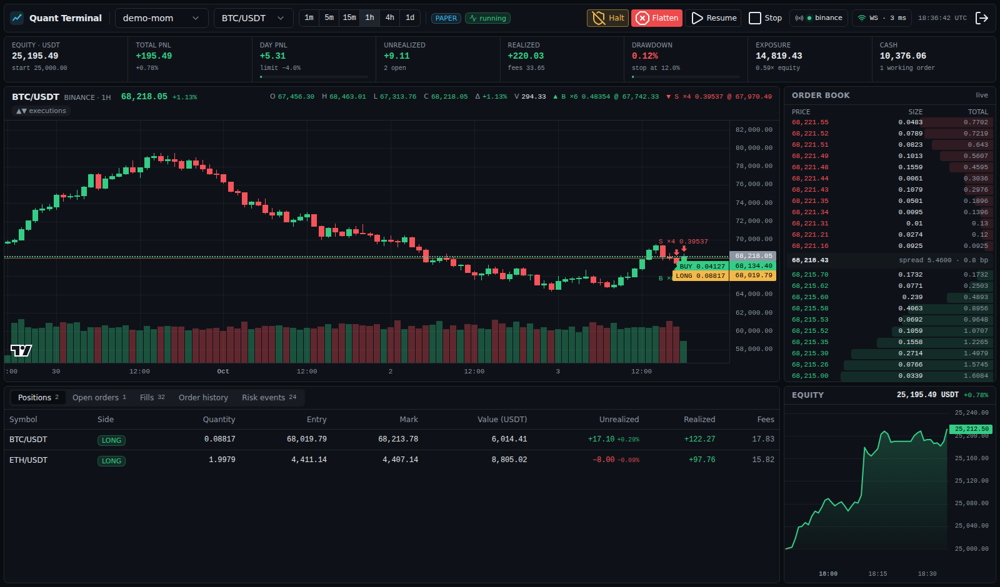
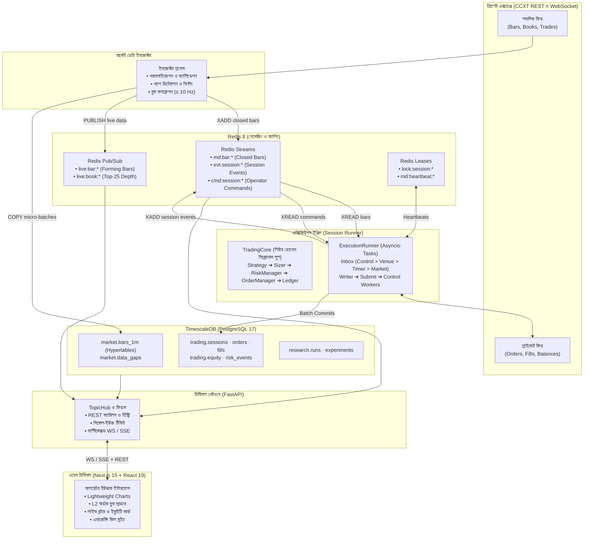

# ক্রিপ্টো কোয়ান্ট টার্মিনাল (Crypto Quant Terminal)

<div align="center">

[](LICENSE)
[](https://www.python.org/)
[](https://nextjs.org/)
[](https://fastapi.tiangolo.com/)
[](https://www.timescale.com/)
[](https://redis.io/)
[](https://pola.rs/)
[](#সিস্টেম-আর্কিটেকচার)

**একটি প্রাতিষ্ঠানিক মানের (Institutional-Grade), ইভেন্ট-ড্রিভেন ক্রিপ্টোকারেন্সি রিসার্চ, ব্যাকটেস্টিং এবং পেপার/লাইভ ট্রেডিং এক্সিকিউশন প্ল্যাটফর্ম — রিয়েল-টাইম ওয়েব টার্মিনাল সহ।**

[English Documentation](README.md) •
[সিস্টেম আর্কিটেকচার](#সিস্টেম-আর্কিটেকচার) •
[মূল ফিচারসমূহ](#মূল-ফিচারসমূহ) •
[ওয়েব টার্মিনাল](#ওয়েব-টার্মিনাল-ইন্টারফেস) •
[কুইকস্টার্ট গাইড](#কুইকস্টার্ট-গাইড) •
[সিএলআই রেফারেন্স](#সিএলআই-ও-কমান্ড-রেফারেন্স) •
[প্রজেক্ট স্ট্রাকচার](#প্রজেক্ট-ফোল্ডার-স্ট্রাকচার)

---


*রিয়েল-টাইম ওয়েব টার্মিনাল: লাইভ ক্যান্ডেলস্টিক চার্ট, L2 অর্ডার বুক ল্যাডার, ট্রেড মার্কার, ব্লটার এবং এমার্জেন্সি কিল-সুইচ।*

</div>

---

## সংক্ষিপ্ত পরিচিতি (Overview)

**Crypto Quant Terminal** একটি পূর্ণাঙ্গ অ্যালগরিদমিক ট্রেডিং প্ল্যাটফর্ম, যা পরিমাণগত ফিন্যান্সে (Quantitative Finance) সবচেয়ে ঝুঁকিপূর্ণ ব্যর্থতা দূর করতে তৈরি করা হয়েছে: **ব্যাকটেস্টিং রেজাল্ট এবং লাইভ প্রোডাকশন এক্সিকিউশনের মধ্যে অমিল (Divergence বা Implementation Drift)**।

কঠোর হেক্সাগোনাল আর্কিটেকচার (Ports and Adapters) এবং ইভেন্ট-ড্রিভেন কোরের সমন্বয়ে এটি প্রদান করে:
1. **উচ্চ-গতির ডেটা ইনজেশন (High-Throughput Ingestion):** ১-মিনিটের মাইক্রো-ব্যাচ ক্যানোনিকাল বার এবং কনফ্লেটেড লেভেল-২ অর্ডার বুক — TimescaleDB-তে স্টোর এবং Redis-এর মাধ্যমে স্ট্রিম হয়।
2. **ডুয়াল-ইঞ্জিন রিসার্চ ও ব্যাকটেস্টিং:** Polars ও NumPy দ্বারা চালিত অতি-দ্রুত ভেক্টরাইজড প্যারামিটার সুইপ এবং একটি ইভেন্ট-ড্রিভেন ব্যাকটেস্টিং ইঞ্জিন যা প্রোডাকশনের সাথে অবিকল ফিল লজিক শেয়ার করে ($10^{-12}$ গাণিতিক নির্ভুলতা নিশ্চিত)।
3. **কঠোর স্ট্র্যাটেজি প্রমোশন ফানেল:** ডেফ্লেটেড শার্প রেশিও (Deflated Sharpe Ratio - DSR), ব্যাকটেস্ট ওভারফিটিং সম্ভাবনা (Probability of Backtest Overfitting - PBO), এবং পার্জড ও এমবার্গো যুক্ত ওয়াক-ফরওয়ার্ড অপ্টিমাইজেশন (Walk-Forward Optimization)।
4. **নির্ভরযোগ্য এক্সিকিউশন ইঞ্জিন (Resilient Execution Engine):** সিঙ্গেল-রাইটার asyncio সেশন লুপ, ডিটারমিনিস্টিক ক্লায়েন্ট অর্ডার আইডি, প্রি-ট্রেড রিস্ক চেক, কেলি/ভোলাটিলিটি প্যারিটি পজিশন সাইজিং, ফরোয়ার্ড-অনলি অর্ডার স্টেট মেশিন এবং হার্ডওয়্যার-স্টাইলের জরুরি কিল সুইচ (`halt`, `flatten`, `resume`, `stop`)।
5. **রিয়েল-টাইম অপারেটর টার্মিনাল:** Next.js 15 এবং React 19 ইন্টারফেস — TradingView Lightweight Charts, সাব-সেকেন্ড অর্ডার বুক আপডেট, এবং রিয়েল-টাইম WebSocket মাল্টিপ্লেক্সিং (SSE ফলব্যাক সহ)।

---

## সিস্টেম আর্কিটেকচার

সিস্টেমটি সম্পূর্ণভাবে **Hexagonal Architecture (Ports and Adapters)** অনুসরণ করে। মূল ডোমেন লজিক কোনো ফ্রেমওয়ার্ক, ডাটাবেজ বা নেটওয়ার্ক লাইব্রেরির উপর নির্ভরশীল নয়; যার ফলে ব্যাকটেস্ট ও লাইভ ট্রেডিং হুবহু একই আচরণ করে।

### রানটাইম টপোলজি



---

### আর্কিটেকচারাল ইনভ্যারিয়েন্টসমূহ (D1–D12)

| নীতি | সিদ্ধান্ত | যৌক্তিক কারণ |
|:---:|:---|:---|
| **D1** | **One Engine, Three Modes** | Paper, sandbox, এবং live — তিনটি মোডই অবিকল একই `TradingCore` ও `ExecutionRunner` ব্যবহার করে। শুধু ভেন্যু অ্যাডাপ্টার পরিবর্তিত হয়। |
| **D2** | **Single-Writer Event Loop** | একটি সেশনের সকল পরিবর্তন একক asyncio টাস্কে সম্পাদিত হয়। ফলে রেস-কন্ডিশন সম্পূর্ণ দূর হয়। |
| **D3** | **Zero Look-Ahead Guarantee** | স্ট্র্যাটেজি শুধুমাত্র ক্লোজড বার পায়। ক্যান্ডেল ক্লোজ $t$ সময়ের সিগন্যাল কেবল $t + \text{latency}$ সময়ে এক্সিকিউট হয়। |
| **D4** | **Exact `Decimal` Accounting** | অর্থ, পরিমাণ, টিক সাইজ, লট ও লেজার হিসাবে পাইথনের `Decimal` ব্যবহার হয়। কোনো ফ্লোট রাউন্ডিং এরর হতে পারে না। |
| **D5** | **Redis Streams for Decisions** | গুরুত্বপূর্ণ ফিড (বার, অর্ডার, কমান্ড, ইভেন্ট) একনলেজড ও রিপ্লে-যোগ্য Redis Streams ব্যবহার করে। |
| **D6** | **TimescaleDB Relational + TS** | হাইপারটেবিল টাইম-সিরিজ অ্যানালিটিক্স এবং রিলেশনাল ACID ট্রেডিং ডাটাবেজ এক প্ল্যাটফর্মে সংযুক্ত। |
| **D7** | **1-Minute Canonical Bars** | সকল উচ্চতর টাইমফ্রেম (5m, 15m, 1h, 1d) ১-মিনিটের ক্যানোনিকাল বার থেকে রোল-আপ হয়ে ক্যালকুলেট হয়। |
| **D8** | **Native Vectorized & Event Parity** | Polars/NumPy ভেক্টরাইজড ইঞ্জিন এবং ইভেন্ট ইঞ্জিনের ফলাফল $10^{-12}$ প্রিসিশনে অবিকল মিলে যায়। |
| **D9** | **Pydantic at Edges, Dataclasses in Core** | এপিআই ও কনফিগারেশনে Pydantic ভ্যালিডেশন; দ্রুত এক্সিকিউশন পাথে ফ্রোজেন স্লটেড ডেটাক্লাস। |
| **D10**| **Two-Key Live Safety Switch** | লাইভ ট্রেডিংয়ের জন্য `CQ_TRADING_MODE=live` এবং `CQ_LIVE_TRADING_ENABLED=true` উভয়ই সক্রিয় থাকতে হয়। |
| **D11**| **Deterministic Reproducibility** | প্রতিটি ব্যাকটেস্ট রান গিট কমিট হ্যাশ, ডেটাসেট হ্যাশ এবং প্যারামিটার সংরক্ষণ করে। |
| **D12**| **Self-Contained SQL Migrations** | নিজস্ব asyncpg মাইগ্রেটর দিয়ে SHA-256 ইন্টিগ্রিটি চেক সহ সরাসরি প্লেইন SQL মাইগ্রেশন পরিচালিত হয়। |

---

## অর্ডার স্টেট মেশিন (Order State Machine)

প্রতিটি অর্ডার একটি নির্দিষ্ট ফরোয়ার্ড-অনলি ফাইনাইট স্টেট মেশিনের মাধ্যমে পরিচালিত হয়:

```
                  ack                   fill                    fill
 PENDING ───────────────► OPEN ───────────────► PARTIALLY_FILLED ───────────────► FILLED
  │   │                    │                           │                            ▲
  │   │ timeout /          │ cancel()                  │ cancel()                   │
  │   │ network drop       ▼                           ▼                            │
  │   │              CANCEL_PENDING ───────────────────────────────────► CANCELLED  │
  │   │                    └── fills keep counting; the last one completes it ──────┘
  │   ▼
  │  UNKNOWN ── look up by client order id ──► OPEN | PARTIALLY_FILLED | FILLED | CANCELLED
  │                                            | REJECTED | EXPIRED
  ▼
 REJECTED   (venue refusal, or NOT_SENT if PENDING persistence failed)
```

- **ডিটারমিনিস্টিক ক্লায়েন্ট অর্ডার আইডি:** `cq` + ৬-অক্ষরের সেশন ট্যাগ + $\text{HMAC-SHA256}(\text{session}, \text{intent})$ থেকে প্রাপ্ত ২৪ অক্ষর। সিস্টেম ক্র্যাশ করলেও পুনরায় শুরু করলে একই আইডি তৈরি হয়, ফলে ডুপ্লিকেট অর্ডার হওয়ার কোনো সুযোগ থাকে না।
- **আইডেমপোটেন্ট ফিলস (Idempotent Fills):** প্রতিটি ফিল `(session_id, venue, symbol, trade_id)` দ্বারা ট্র্যাকিং করা হয় এবং লেজারে একবারই যুক্ত হয়।
- **রিস্ক রিফিউজাল:** প্রি-ট্রেড সাইজিং নিয়ম না মানলে তা `trading.risk_events`-এ অডিট হিসেবে জমা হয় এবং কোনো ফ্যান্টম অর্ডার তৈরি করে না।

---

## স্ট্র্যাটেজি রিসার্চ ও প্রমোশন ফানেল

লাইভ মূলধন বরাদ্দের আগে প্রতিটি স্ট্র্যাটেজিকে ৮টি পরিসংখ্যানিক যাচাইকরণ ধাপ পার হতে হয়:

1. **Backfill:** এক্সচেঞ্জ REST API থেকে যাচাইকৃত ১-মিনিটের হিস্টোরিক্যাল ডেটা TimescaleDB-তে স্টোর করা।
2. **Feature Generation:** Polars এক্সপ্রেশনের মাধ্যমে লুক-অ্যাহেড বায়াস মুক্ত ফিচার তৈরি।
3. **Vectorized Parameter Sweep:** লক্ষাধিক প্যারামিটার কম্বিনেশনে উচ্চগতির কলামনার গ্রিড/র‍্যান্ডম সার্চ।
4. **Event-Driven Confirmation:** লেটেন্সি, মেকার/টেকার কিউ ডায়নামিক্স ও স্প্রেড মডেল সহ ইভেন্ট ভেরিফিকেশন ($10^{-12}$ প্যারিটি)।
5. **Walk-Forward Optimization:** রোলিং ইন-স্যাম্পল ও আউট-অব-স্যাম্পল স্প্লিট (পার্জড ও এমবার্গো উইন্ডো সহ ডেটা লিকেজ রোধ)।
6. **Robustness & Overfitting Audit:** Deflated Sharpe Ratio (DSR) এবং Probability of Backtest Overfitting (PBO) মূল্যায়ন।
7. **Paper Trading Deployment:** লাইভ মার্কেট ফিডের বিপরীতে মাল্টি-ডে সিমুলেটেড এক্সিকিউশন।
8. **Live Deployment:** কঠোর নশোনাল এক্সপোজার ও ডেইলি ড্র-ডাউন সেফটি ক্যাপ সহ লাইভ ক্যাপিটাল ট্রেডিং।

---

## মূল ফিচারসমূহ

### ১. মার্কেট ডেটা ও ইনজেশন
- ইউনিফায়েড CCXT WebSocket ফিড (Binance, OKX, Bybit ইত্যাদি স্পট মার্কেট সাপোর্ট)।
- মিসিং ক্যান্ডেল অডিট ও অটোমেটিক ব্যাকফিলিং।
- CPU লোড নিয়ন্ত্রণে টপ-২৫ অর্ডার বুক ডেপথ কনফ্লেশন ($\le 10\text{ Hz}$)।
- ১-মিনিটের ক্যানোনিকাল হাইপারটেবিল এবং 5m, 15m, 1h, 1d কন্টিনিউয়াস এগ্রিগেট রোল-আপ।

### ২. রিস্ক ম্যানেজমেন্ট ও এমার্জেন্সি কিল সুইচ
- **প্রি-ট্রেড লিমিট চেক:** ম্যাক্সিমাম অর্ডার নশোনাল, ম্যাক্সিমাম গ্রস এক্সপোজার, ডেইলি লস লিমিট, ম্যাক্সিমাম ড্র-ডাউন ক্যাপ।
- **স্কেল ডেটা প্রটেকশন:** মার্কেট ডেটা হার্টবিট ১৫ সেকেন্ডের বেশি বিলম্বিত হলে স্বয়ংক্রিয়ভাবে নতুন অর্ডার ব্লক করা হয়।
- **জরুরি কিল সুইচ:** `halt` (অর্ডার বাতিল ও নতুন ট্রেড বন্ধ), `flatten` (মার্কেট অর্ডারে সব পজিশন সাথে সাথে লিকুইডেট), `resume` (স্বাভাবিক ট্রেডিং পুনরায় চালু), `stop` (সেশন ক্লোজ)।

### ৩. কোয়ান্টিটেটিভ পজিশন সাইজিং মডেল
- ফিক্সড ফ্র্যাকশনাল সাইজিং (Fixed Fractional Sizing)।
- ফ্র্যাকশনাল কেলি ক্রাইটেরিয়ন (Fractional Kelly Criterion) — ডায়নামিক উইন-রেট ও পে-অফ এডজাস্টমেন্ট সহ।
- ভোলাটিলিটি প্যারিটি (Volatility Parity) — রোলিং ভোলাটিলিটির বিপরীতে পজিশন ওয়েট নির্ধারণ।

---

## ওয়েব টার্মিনাল ইন্টারফেস

**Next.js 15**, **React 19**, এবং **Tailwind CSS** দিয়ে নির্মিত অপারেটর ককপিট:

- **TradingView Lightweight Charts:** রিয়েল-টাইম ক্যান্ডেলস্টিক চার্ট, ট্রেড এন্ট্রি/এক্সিট মার্কার এবং ওপেন লিমিট অর্ডার প্রাইস লাইন।
- **Level-2 Order Book Ladder:** ১২-লেভেলের বিড/আস্ক অর্ডার বুক ডেপথ, অ্যানিমেটেড সাইজ বার এবং বেসিস-পয়েন্ট (bps) স্প্রেড মিটার।
- **মাল্টি-ট্যাব এক্সিকিউশন ব্লটার:**
  - **Orders:** পেন্ডিং, ওপেন, ফিল্ড, ক্যানসেলড ও রিজেক্টেড অর্ডারের বিস্তারিত তথ্য।
  - **Positions:** ওপেন পজিশন, এভারেজ এন্ট্রি প্রাইস, মার্ক প্রাইস এবং রিয়েলাইজড/আনরিয়েলাইজড PnL।
  - **Trades (Fills):** টাইমস্ট্যাম্প, লিকুইডিটি ফ্ল্যাগ (Maker/Taker) এবং ফি সহ নির্ভুল ট্রেড হিস্ট্রি।
  - **Risk Events:** প্রি-ট্রেড রিস্ক লঙ্ঘন ও সাইজিং অডিট লগ।
- **লাইভ মেট্রিক স্ট্রিপ:** সেশন স্টেট, মোট ইকুইটি, ক্যাশ ব্যালেন্স, কারেন্ট ড্র-ডাউন, দৈনিক লাভ-ক্ষতি, ফিড লেটেন্সি এবং ডেটা হার্টবিট টাইমার।
- **এমার্জেন্সি কিল সুইচ কন্ট্রোল প্যানেল:** এক ক্লিকে `HALT`, `FLATTEN`, `RESUME`, বা `STOP` কমান্ড এক্সিকিউট করা যায়।
- **মাল্টিপ্লেক্সড স্ট্রিমিং:** রিয়েল-টাইম WebSocket স্ট্রিমিং (অটো-রিকানেক্ট ও টোকেন অথেনটিকেশন সহ) এবং নির্ভরযোগ্য SSE ফলব্যাক।

---

## কুইকস্টার্ট গাইড

Crypto Quant Terminal দুটি পদ্ধতিতে চালানো যায়:
- **অপশন A: স্ট্যান্ডঅ্যালোন ডেমো মোড (Standalone Demo Mode)** — কোনো ডকার বা ডাটাবেজ ছাড়া সাথে সাথে মেমোরিতে লাইভ সিমুলেশন চালিয়ে দেখার জন্য (সবচেয়ে দ্রুত ও সহজ)।
- **অপশন B: ফুল প্রোডাকশন স্ট্যাক (Full Production Stack)** — TimescaleDB + Redis + CCXT Ingestor + FastAPI Gateway + Next.js Web UI।

---

### অপশন A: স্ট্যান্ডঅ্যালোন ডেমো মোড (সুপারিশকৃত)

এই মোডে একটি বিল্ট-ইন ইন-মেমোরি গেটওয়ে (`backend/serve_standalone.py`) চলে, যা লাইভ ক্রিপ্টো মার্কেট (BTC/USDT, ETH/USDT, SOL/USDT), ট্রেডিং সেশন, অর্ডার বুক এবং অর্ডার এক্সিকিউশন সিমুলেট করে। **এর জন্য Docker বা কোনো বাহ্যিক ডাটাবেজের প্রয়োজন নেই।**

#### ১. পূর্বশর্ত
- **Python:** 3.11+ ([uv](https://docs.astral.sh/uv/) ইন্সটল থাকা ভালো)
- **Node.js:** v22+ এবং `npm`

#### ২. ব্যাকএন্ড গেটওয়ে চালু করুন
টার্মিনাল বা PowerShell-এ রান করুন:
```bash
# ব্যাকএন্ড ফোল্ডারে প্রবেশ করুন
cd backend

# স্ট্যান্ডঅ্যালোন সার্ভার চালান
uv run python serve_standalone.py
```
*গেটওয়ে `http://127.0.0.1:8000`-এ চালু হবে। Swagger Docs পাওয়া যাবে `http://127.0.0.1:8000/api/docs` এ।*  
*ডিফল্ট এপিআই টোকেন:* `89ee2cb3c2289389378734ff5b3b29b60b50b05a6ed13109`

#### ৩. ওয়েব টার্মিনাল চালু করুন
আরেকটি নতুন টার্মিনাল উইন্ডো খুলুন:
```bash
# ফ্রন্টএন্ড ফোল্ডারে প্রবেশ করুন
cd frontend

# ডিপেন্ডেন্সি ইন্সটল করুন (প্রথমবার)
npm install

# Next.js ডেভেলপমেন্ট সার্ভার চালু করুন
npm run dev
```

#### ৪. ব্রাউজারে টার্মিনাল ওপেন করুন
1. ব্রাউজারে **`http://localhost:3000`** লিংকে যান।
2. ডিফল্ট টোকেনটি পেস্ট করুন: `89ee2cb3c2289389378734ff5b3b29b60b50b05a6ed13109`
3. **"Remember on this device"** টিক দিয়ে **Connect** বাটনে ক্লিক করুন।
4. সাথে সাথে লাইভ ট্রেডিং টার্মিনাল লোড হবে এবং লাইভ ক্যান্ডেল, অর্ডার বুক ও ট্রেড দেখতে পাবেন।

---

### অপশন B: ফুল প্রোডাকশন স্ট্যাক (TimescaleDB + Redis সহ)

আসল ক্রিপ্টো এক্সচেঞ্জ কানেক্টিভিটি, ডাটাবেজ পারসিসটেন্স এবং হিস্টোরিক্যাল ডেটা ইনজেশনের জন্য:

#### ১. এনভায়রনমেন্ট কনফিগারেশন
- **লিনাক্স / ম্যাক / Git Bash:**
  ```bash
  make env
  ```
- **উইন্ডোজ (PowerShell):**
  ```powershell
  Copy-Item .env.example .env
  python -c "import secrets, pathlib; p = pathlib.Path('.env'); s = p.read_text(); [s := s.replace('<generate>', secrets.token_hex(24), 1) for _ in range(s.count('<generate>'))]; p.write_text(s)"
  ```

#### ২. ইনফ্রাস্ট্রাকচার ও ডাটাবেজ মাইগ্রেশন
- **লিনাক্স / ম্যাক / Git Bash:**
  ```bash
  # TimescaleDB ও Redis কন্টেইনার চালু করুন
  make up

  # ডাটাবেজ মাইগ্রেশন রান করুন
  make migrate
  ```
- **উইন্ডোজ (PowerShell):**
  ```powershell
  # কন্টেইনার ব্যাকগ্রাউন্ডে চালু করুন
  docker compose up -d --wait

  # মাইগ্রেশন প্রয়োগ করুন
  cd backend
  uv run cq db migrate
  cd ..
  ```

#### ৩. লাইভ মার্কেট ডেটা স্ট্রিমিং
- **লিনাক্স / ম্যাক / Git Bash:**
  ```bash
  make ingest SYMBOLS="BTC/USDT ETH/USDT"
  ```
- **উইন্ডোজ (PowerShell):**
  ```powershell
  cd backend
  uv run cq ingest live -s BTC/USDT -s ETH/USDT
  ```

#### ৪. ট্রেডিং সেশন চালু করা
- **লিনাক্স / ম্যাক / Git Bash:**
  ```bash
  make trade SESSION=mom-1 STRATEGY=momentum SYMBOL=BTC/USDT TF=1h
  ```
- **উইন্ডোজ (PowerShell):**
  ```powershell
  cd backend
  uv run cq trade run --session mom-1 --strategy momentum --symbol BTC/USDT --timeframe 1h
  ```

#### ৫. গেটওয়ে ও ফ্রন্টএন্ড চালানো
- **FastAPI গেটওয়ে (পোর্ট 8000):**
  - *লিনাক্স/ম্যাক:* `make api`
  - *উইন্ডোজ:* `cd backend; uv run cq api serve`
- **Next.js ফ্রন্টএন্ড (পোর্ট 3000):**
  - *লিনাক্স/ম্যাক:* `make web-dev`
  - *উইন্ডোজ:* `cd frontend; npm run dev`

---

## সিএলআই ও কমান্ড রেফারেন্স

প্লাটফর্মে সুবিধাজনক `Makefile` কমান্ড এবং সরাসরি `cq` সিএলআই উভয়ই রয়েছে:

### ইনফ্রাস্ট্রাকচার ও ডাটাবেজ
| Make কমান্ড | সমতুল্য CLI কমান্ড | বিবরণ |
|:---|:---|:---|
| `make up` | `docker compose up -d --wait` | TimescaleDB এবং Redis কন্টেইনার চালু করে। |
| `make down` | `docker compose down` | কন্টেইনারগুলো বন্ধ করে (ডেটা অক্ষত থাকে)। |
| `make ps` | `docker compose ps` | সার্ভিসের স্বাস্থ্য ও স্ট্যাটাস প্রদর্শন করে। |
| `make logs` | `docker compose logs -f` | ইনফ্রাস্ট্রাকচার লগ লাইভ প্রদর্শন করে। |
| `make migrate` | `uv run cq db migrate` | ডাটাবেজ মাইগ্রেশন সম্পাদন করে। |
| `make reset CONFIRM=yes` | `docker compose down --volumes` | কন্টেইনার ও সকল ডেটা ভলিউম সম্পূর্ণ মুছে ফেলে। |

### ডেটা ইনজেশন ও ব্যাকফিল
| Make কমান্ড | সমতুল্য CLI কমান্ড | বিবরণ |
|:---|:---|:---|
| `make ingest SYMBOLS="..."` | `uv run cq ingest live -s SYMBOL` | লাইভ মার্কেট ডেটা ইনজেশন শুরু করে। |
| `make backfill START=...` | `uv run cq ingest backfill --start ...` | হিস্টোরিক্যাল ১-মিনিট ক্যান্ডেল ব্যাকফিল করে। |
| `make gaps START=...` | `uv run cq ingest gaps --start ...` | ডাটাবেজে অনুপস্থিত বার অডিট করে রিপোর্ট দেয়। |

### রিসার্চ ও ব্যাকটেস্টিং
| Make কমান্ড | সমতুল্য CLI কমান্ড | বিবরণ |
|:---|:---|:---|
| `make strategies` | `uv run cq backtest strategies` | রেজিস্টার্ড স্ট্র্যাটেজির তালিকা ও প্যারামিটার স্কিমা দেখায়। |
| `make backtest STRATEGY=...` | `uv run cq backtest run -s SYM -m strat` | নির্দিষ্ট স্ট্র্যাটেজির ইভেন্ট-ড্রিভেন ব্যাকটেস্ট চালায়। |
| `make sweep STRATEGY=...` | `uv run cq backtest sweep -s SYM -m strat` | Polars দিয়ে হাই-স্পিড ভেক্টরাইজড প্যারামিটার সুইপ চালায়। |

### লাইভ ও পেপার ট্রেডিং
| Make কমান্ড | সমতুল্য CLI কমান্ড | বিবরণ |
|:---|:---|:---|
| `make trade SESSION=s1 ...` | `uv run cq trade run --session s1 ...` | ট্রেডিং সেশন চালু বা রিজিউম করে। |
| `make session SESSION=s1` | `uv run cq trade status --session s1` | সেশনের ইকুইটি, পজিশন ও স্ট্যাটাস পরিদর্শন করে। |
| `make orders SESSION=s1` | `uv run cq trade orders --session s1` | সেশনের অর্ডার হিস্ট্রি প্রদর্শন করে। |
| `make halt SESSION=s1` | `uv run cq trade halt --session s1` | **কিল সুইচ:** ওপেন অর্ডার বাতিল ও নতুন এন্ট্রি বন্ধ করে। |
| `make flatten SESSION=s1` | `uv run cq trade flatten --session s1` | **কিল সুইচ:** সব অর্ডার বাতিল করে সব পজিশন ক্লোজ করে। |
| `make resume SESSION=s1` | `uv run cq trade resume --session s1` | সেশন স্বাভাবিক অবস্থায় ফিরিয়ে আনে। |
| `make stop SESSION=s1` | `uv run cq trade stop --session s1` | সেশন ইঞ্জিনটি নিরাপদে বন্ধ করে। |

---

## টেস্টিং ও কোয়ালিটি নিশ্চয়তা

প্রকল্পটিতে কঠোর কোয়ালিটি কন্ট্রোল এবং টেস্ট কভারেজ বজায় রাখা হয়েছে:

```bash
# ব্যাকএন্ড কোড ফরম্যাটিং ও লিন্ট চেক
uv run ruff check backend/
uv run ruff format --check backend/

# স্ট্যাটিক টাইপ অ্যানালাইসিস (Mypy Strict)
uv run mypy backend/

# হেক্সাগোনাল ইমপোর্ট রুলস যাচাই (Import Linter)
uv run lint-imports --config backend/pyproject.toml

# ইউনিট টেস্ট ও প্যারিটি টেস্ট রান
uv run pytest -m "not integration"
```

- **প্যারিটি টেস্ট স্যুট (`-m parity`):** ভেক্টরাইজড Polars ইঞ্জিন এবং ইভেন্ট-ড্রিভেন ইঞ্জিনের সিগন্যাল, ফিল এবং পোর্টফোলিও ইকুইটি $10^{-12}$ নির্ভুলতায় যাচাই করে।
- **কন্ট্রাক্ট টেস্ট স্যুট:** মক ও প্রোডাকশন অ্যাডাপ্টারের আচরণ অবিকল একই কিনা নিশ্চিত করে।
- **হাইপোথিসিস প্রপার্টি টেস্ট:** অর্ডার ম্যাচিং, ফি ক্যালকুলেশন এবং ডেসিমাল রাউন্ডিং-এর এজ-কেস টেস্ট করে।

---

## প্রজেক্ট ফোল্ডার স্ট্রাকচার

```
crypto-quant-terminal/
├── Makefile                      # স্ট্যান্ডার্ড ডেভেলপার কমান্ড
├── docker-compose.yml            # TimescaleDB ও Redis কনফিগারেশন
├── .env.example                  # এনভায়রনমেন্ট কনফিগারেশন টেমপ্লেট
├── README.md                     # ইংরেজি মূল ডকুমেন্টেশন
├── README.bn.md                  # বাংলা ডকুমেন্টেশন
├── docs/
│   ├── ARCHITECTURE.md           # বিস্তারিত আর্কিটেকচারাল স্পেসিফিকেশন
│   └── images/                   # স্ক্রিনশট ও ডায়াগ্রাম
├── infra/
│   ├── timescaledb/initdb/       # PostgreSQL বুটস্ট্র্যাপ স্ক্রিপ্ট
│   └── redis/redis.conf          # Redis পারসিসটেন্স কনফিগারেশন
├── backend/
│   ├── pyproject.toml            # পাইথন প্যাকেজিং ও ডিপেন্ডেন্সি
│   ├── uv.lock                   # ডিপেন্ডেন্সি লকফাইল
│   ├── serve_standalone.py       # জিরো-ডিপেন্ডেন্সি স্ট্যান্ডঅ্যালোন গেটওয়ে
│   ├── src/crypto_quant/         # মূল সোর্স কোড
│   │   ├── domain/               # পিউর বিজনেস ডোমেন (নো I/O, নো ফ্রেমওয়ার্ক)
│   │   ├── strategies/           # ট্রেডিং স্ট্র্যাটেজি (momentum, mean reversion)
│   │   ├── application/          # ইউজ কেস, এক্সিকিউশন রানার ও পোর্টস
│   │   ├── infrastructure/       # TimescaleDB, Redis, CCXT অ্যাডাপ্টার
│   │   ├── bootstrap/            # ডিপেন্ডেন্সি ইনজেকশন ও ওয়্যারিং
│   │   └── entrypoints/          # Typer CLI (`cq`) এবং FastAPI গেটওয়ে
│   └── tests/                    # ইউনিট, প্যারিটি, কন্ট্রাক্ট ও ইন্টিগ্রেশন টেস্ট
└── frontend/
    ├── package.json              # Next.js ডিপেন্ডেন্সি
    ├── tsconfig.json             # টাইপস্ক্রিপ্ট কনফিগারেশন
    └── src/
        ├── app/                  # Next.js App Router ও ডার্ক থিম
        ├── components/terminal/  # চার্ট, অর্ডার বুক, ব্লটার, কিল সুইচ
        ├── components/ui/        # Radix / shadcn প্রিমিটিভ
        ├── stores/               # Zustand স্টেট ম্যানেজমেন্ট
        └── lib/                  # WebSocket / SSE স্ট্রিমিং ক্লায়েন্ট
```

---

## লাইসেন্স

এই প্রজেক্টটি [MIT License](LICENSE) এর আওতাভুক্ত।
