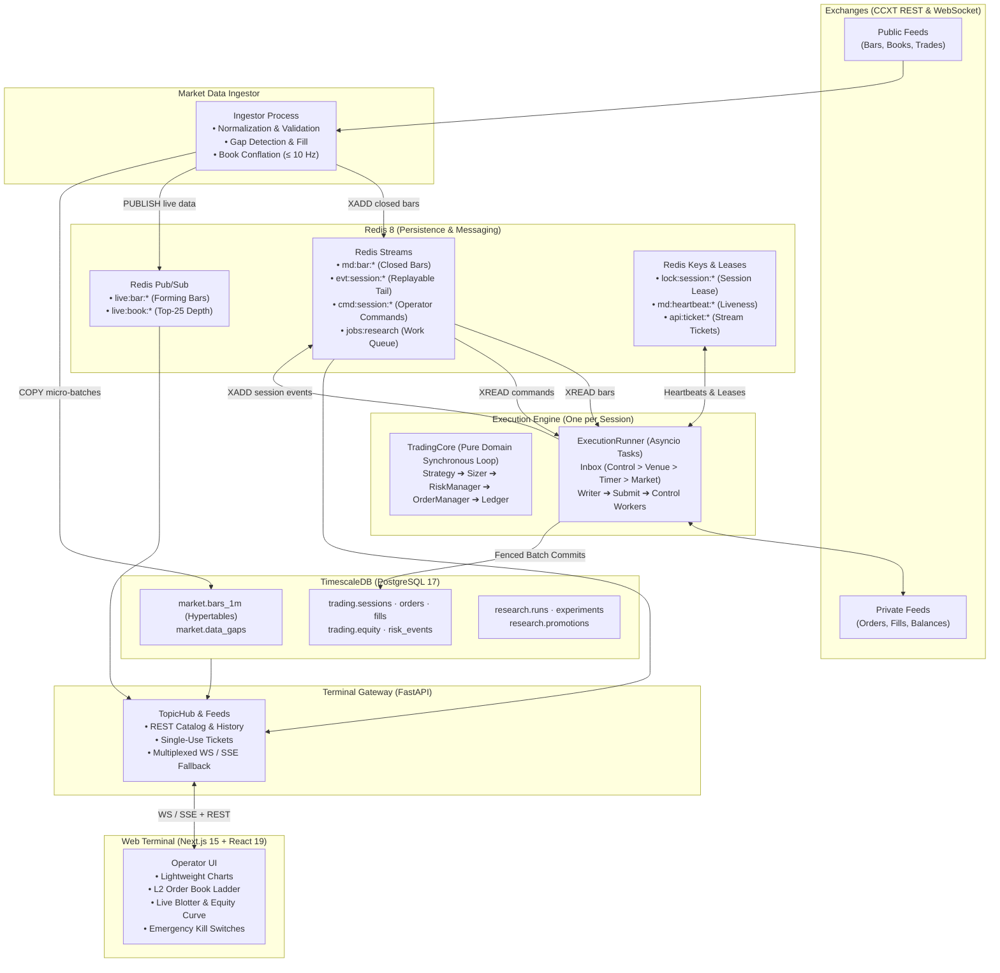

# Crypto Quant Terminal

<div align="center">

[](LICENSE)
[](https://www.python.org/)
[](https://nextjs.org/)
[](https://fastapi.tiangolo.com/)
[](https://www.timescale.com/)
[](https://redis.io/)
[](https://pola.rs/)
[](#system-architecture)

**An institutional-grade, event-driven cryptocurrency research, backtesting, and paper/live trading execution platform with a real-time web terminal.**

[বাংলা সংস্করণ (Bengali Documentation)](README.bn.md) •
[Architecture](#system-architecture) •
[Key Features](#key-features) •
[Web Terminal Interface](#web-terminal-interface) •
[Quickstart](#quickstart) •
[CLI & Makefile](#cli--workflow-reference) •
[Repository Layout](#repository-layout)

---


*Real-time web terminal monitoring an active paper trading session with live order books, candlestick charts, trade markers, blotter, and kill-switches.*

</div>

---

## Overview

**Crypto Quant Terminal** is an end-to-end algorithmic trading system designed to eliminate the most expensive failure mode in quantitative finance: **divergence between backtesting and live production execution**. 

Built upon strict hexagonal boundaries and an event-driven core, it provides:
1. **High-Throughput Data Ingestion:** Micro-batched 1-minute canonical bars and conflated Level-2 order books stored in TimescaleDB and streamed through Redis.
2. **Dual-Engine Research & Backtesting:** Ultra-fast vectorized parameter sweeps (via Polars and NumPy) paired with an event-driven backtesting engine sharing identical fill logic with production (verified to $10^{-12}$ mathematical parity).
3. **Rigorous Research Promotion Funnel:** Statistical gating using Deflated Sharpe Ratio (DSR), Probability of Backtest Overfitting (PBO), and purged/embargoed Walk-Forward Optimization.
4. **Resilient Execution Engine:** A single-writer asyncio session loop enforcing deterministic client order IDs, pre-trade risk checks, Kelly/Volatility parity sizing, forward-only order state machines, and hardware-style kill switches (`halt`, `flatten`, `resume`, `stop`).
5. **Real-Time Operator Terminal:** A modern Next.js 15 / React 19 interface with TradingView Lightweight Charts, real-time WebSocket multiplexing with SSE fallback, and sub-second order book updates.

---

## System Architecture

The system follows **Hexagonal Architecture (Ports and Adapters)**. Domain rules have zero dependencies on frameworks, databases, or network libraries, ensuring identical behavior across backtest replays and live exchange trading.

### Runtime Topology



---

### Layer Architecture & Import Boundaries

Inward-only dependency rules are strictly validated by `import-linter` during CI/CD checks:

```
src/crypto_quant/
├── domain/            PURE: stdlib, Decimal, Polars/NumPy compute only. Zero I/O, zero Pydantic.
│   ├── market/        InstrumentId, Timeframe, Bar, OrderBook, MarketFrame
│   ├── orders/        Order aggregate, forward-only state machine, deterministic IDs
│   ├── risk/          RiskManager (pre-trade checks, drawdown/day-loss caps, price bands)
│   ├── portfolio/     Ledger: cash, positions, fees, realized PnL in exact Decimal
│   ├── execution/     Maker/taker fee models, square-root slippage, latency models
│   └── strategy/      Strategy base classes, streaming indicators, Context
├── strategies/        Concrete strategies (momentum, mean reversion). Imports domain only.
├── application/       ORCHESTRATION: domain + ports, no framework dependencies.
│   ├── ports/         ExecutionVenue, TradingStore, TradingFeed, TopicHub, Repositories
│   ├── execution/     TradingCore, OrderManager, ExecutionRunner, TradingSession
│   ├── ingestion/     Live pipeline, candle tracker, gap filling, backfill
│   └── terminal/      Topics, TopicHub, candle aggregator, session reducer
├── infrastructure/    DRIVEN ADAPTERS: implementations of application ports.
│   ├── persistence/   TimescaleDB/PostgreSQL asyncpg pools, SQL migrations
│   ├── messaging/     Redis Streams, Pub/Sub mux, distributed session leases
│   ├── exchanges/     CCXT REST & WebSocket integration, market specifications
│   └── observability/ Structlog JSON logging, Prometheus metrics exporters
├── bootstrap/         COMPOSITION ROOT: wires adapters to ports based on active mode.
└── entrypoints/       DRIVING ADAPTERS: CLI (`cq`) and FastAPI Gateway (`cq api serve`).
```

---

### Core Architectural Invariants (D1–D12)

| Rule | Decision | Rationale |
|:---:|:---|:---|
| **D1** | **One Engine, Three Modes** | Paper, sandbox, and live share the exact same `TradingCore` and `ExecutionRunner`. Only the venue adapter shifts. |
| **D2** | **Single-Writer Event Loop** | All mutations for a session occur in a single asyncio task. `TradingCore` is synchronous, pure, and produces deterministic effects. |
| **D3** | **Zero Look-Ahead Guarantee** | Strategies receive only closed bars. Indicators are strictly backward-looking. Signals at close $t$ only execute at $t + \text{latency}$. |
| **D4** | **Exact `Decimal` Accounting** | Money, quantities, tick sizes, lots, and ledger values use Python `Decimal`. `float64` is restricted to vectorized research. |
| **D5** | **Redis Streams for Decisions** | Decision-critical feeds (bars, orders, commands, events) use acknowledged, replayable Redis Streams; Pub/Sub is reserved for latest-wins display. |
| **D6** | **TimescaleDB Relational + TS** | Unified database for analytical time-series bars and relational ACID orders, fills, and ledger states. |
| **D7** | **1-Minute Canonical Bars** | All higher timeframes (5m, 15m, 1h, 1d) are derived continuous aggregates of 1-minute bars. |
| **D8** | **Native Vectorized & Event Parity** | Custom Polars/NumPy engine achieves $10^{-12}$ parity with the event engine, eliminating dual-implementation bugs. |
| **D9** | **Pydantic at Edges, Dataclasses in Core** | Strict Pydantic v2 validation on API/config boundaries; frozen slotted dataclasses in hot execution paths. |
| **D10**| **Two-Key Live Safety Switch** | Live execution requires `CQ_TRADING_MODE=live` AND `CQ_LIVE_TRADING_ENABLED=true`, non-withdrawable keys, and hard USD caps. |
| **D11**| **Deterministic Reproducibility** | Every backtest manifest fingerprints git commit SHA, dataset hash, cost parameters, and seed. |
| **D12**| **Self-Contained SQL Migrations** | Plain SQL migrations executed via transactional asyncpg migrator with SHA-256 integrity verification. |

---

## Order Lifecycle & State Machine

Every order transitions forward-only through a formal finite state machine. A stale exchange notification or duplicated message cannot corrupt the internal order state.

```
                  ack                   fill                    fill
 PENDING ───────────────► OPEN ───────────────► PARTIALLY_FILLED ───────────────► FILLED
  │   │                    │                           │                            ▲
  │   │ timeout /          │ cancel()                  │ cancel()                   │
  │   │ network drop       ▼                           ▼                            │
  │   │              CANCEL_PENDING ───────────────────────────────────► CANCELLED  │
  │   │                    └── fills keep counting; the last one completes it ──────┘
  │   ▼
  │  UNKNOWN ── look up by client order id ──► OPEN | PARTIALLY_FILLED | FILLED | CANCELLED
  │                                            | REJECTED | EXPIRED
  ▼
 REJECTED   (venue refusal, or NOT_SENT if PENDING persistence failed)
```

- **Deterministic Client Order IDs:** `cq` + 6-char session tag + 24 characters of $\text{HMAC-SHA256}(\text{session}, \text{intent})$. Replaying after a process crash reconstructs the identical ID, preventing duplicate order placement.
- **Idempotent Fills:** Every fill is uniquely keyed by `(session_id, venue, symbol, trade_id)` and applied once to the ledger.
- **Risk Refusals:** Pre-trade sizing refusals produce `trading.risk_events` audit rows and never generate phantom `REJECTED` orders.

---

## Research & Strategy Promotion Funnel

Strategies must pass through an 8-stage statistical verification funnel before being authorized for capital allocation:

```
┌──────────────────┐     ┌──────────────────┐     ┌──────────────────┐     ┌──────────────────┐
│ 1. Backfill      │ ──► │ 2. Features      │ ──► │ 3. Vector Sweep  │ ──► │ 4. Event Confirm │
│ Clean history    │     │ Shift-guarded    │     │ 10⁴–10⁶ configs  │     │ Parity check     │
│ Gap audit        │     │ Closed bars only │     │ Polars + NumPy   │     │ Error ≤ 1e-12    │
└──────────────────┘     └──────────────────┘     └──────────────────┘     └────────┬─────────┘
                                                                                    │
┌──────────────────┐     ┌──────────────────┐     ┌──────────────────┐     ┌────────▼─────────┐
│ 8. Live Capital  │ ◄── │ 7. Paper Trading │ ◄── │ 6. Robustness    │ ◄── │ 5. Walk-Forward  │
│ Two-key armed    │     │ Real execution   │     │ DSR & PBO tests  │     │ Purged & embargo │
│ Hard USD caps    │     │ Zero drift       │     │ Monte Carlo      │     │ OOS metrics only │
└──────────────────┘     └──────────────────┘     └──────────────────┘     └──────────────────┘
```

1. **Backfill:** Validated historical data via CCXT REST into TimescaleDB.
2. **Feature Generation:** Pure Polars backward-only expressions.
3. **Vectorized Parameter Sweep:** Grid/random search across parameter spaces using high-speed columnar operations.
4. **Event-Driven Confirmation:** Verification against latency, maker/taker queue dynamics, and spread models.
5. **Walk-Forward Optimization:** Rolling In-Sample/Out-of-Sample splits with purging and embargo windows to prevent label leakage.
6. **Robustness & Overfitting Audit:** Evaluation of Deflated Sharpe Ratio (DSR) and Probability of Backtest Overfitting (PBO).
7. **Paper Deployment:** Multi-day dry-run against live market feeds.
8. **Live Deployment:** Execution with hard notional and daily drawdown safety gates.

---

## Key Features

### 1. Market Data & Ingestion
- Real-time streaming for spot markets (Binance, OKX, Bybit, etc.) using unified CCXT WebSocket feeds.
- Automated sequence-gap detection and backfilling via REST.
- Top-25 order book depth conflation ($\le 10\text{ Hz}$) to minimize CPU churn.
- 1-minute base hypertable with continuous aggregate rollups for 5m, 15m, 1h, and 1d candles.

### 2. Risk Management & Kill Switches
- **Pre-trade limits:** Maximum order notional, maximum gross exposure, daily loss limit, maximum drawdown cap.
- **Stale data protection:** Orders are automatically rejected if market data heartbeats are older than 15 seconds.
- **Operator Kill Switches:** Instant `halt` (cancels open orders, blocks new risk), `flatten` (market liquidation of all open inventory), and `resume` / `stop` via CLI or Web Terminal.

### 3. Quantitative Sizing Models
- Fixed fractional sizing.
- Fractional Kelly Criterion sizing with dynamic win-rate and payoff updates.
- Volatility parity sizing adjusting position weights inversely to rolling volatility.

---

## Web Terminal Interface

The web interface is an institutional-grade operator cockpit built with **Next.js 15**, **React 19**, and **Tailwind CSS**, designed for sub-second situational awareness:

- **TradingView Lightweight Charts:** Real-time multi-timeframe candlestick visualization, active trade entry/exit markers, and open limit order price lines.
- **Level-2 Order Book Ladder:** 12-level bid/ask order book depth with animated size bars, spread computation in basis points (bps), and best bid/ask indicators.
- **Multi-Tab Execution Blotter:**
  - **Orders:** Working, filled, cancelled, and rejected orders with deterministic client IDs.
  - **Positions:** Current symbol positions, average entry prices, mark prices, and unrealized/realized PnL.
  - **Trades (Fills):** Exact execution log with timestamps, liquidity flags (maker/taker), and fee accounting.
  - **Risk Events:** Pre-trade validation audits, rejected sizing events, and limit violation alerts.
- **Real-Time Metric Strip:** Active session status, total equity curve, cash balance, current drawdown, daily PnL, feed latency, and market data heartbeat timers.
- **Hardware-Style Emergency Kill Switches:**
  - `HALT`: Instantly cancels all open orders and rejects any incoming strategy signals.
  - `FLATTEN`: Cancels all working orders and executes market liquidation on all open inventory.
  - `RESUME`: Clears operator halt and permits normal signal execution to resume.
  - `STOP`: Safely tears down the execution session runner.
- **Resilient Multiplexed Streaming:** Native WebSockets with automatic reconnection, ticket-based handshake authentication, and seamless fallback to Server-Sent Events (SSE).

---

## Quickstart

You can run Crypto Quant Terminal in two ways:
- **Option A: Standalone Demo Mode** (Instant start, zero Docker or database dependencies, in-memory live market and trading simulation).
- **Option B: Full Production Stack** (TimescaleDB + Redis + Ingestor + Gateway + Web App).

---

### Option A: Standalone Mode (Recommended for Evaluation)

The repository provides an in-memory development gateway (`backend/serve_standalone.py`) that emulates live crypto markets (BTC/USDT, ETH/USDT, SOL/USDT), trading sessions, order books, and real-time execution without requiring Docker or external databases.

#### 1. Prerequisites
- **Python:** 3.11+ (Managed automatically with [uv](https://docs.astral.sh/uv/))
- **Node.js:** v22+ and `npm`

#### 2. Start the Backend Gateway
```bash
# Navigate to backend
cd backend

# Launch standalone development server
uv run python serve_standalone.py
```
*The standalone gateway starts at `http://127.0.0.1:8000` with Swagger docs at `http://127.0.0.1:8000/api/docs`.*  
*Default API Token:* `89ee2cb3c2289389378734ff5b3b29b60b50b05a6ed13109`

#### 3. Start the Web Terminal
Open a new terminal window:
```bash
# Navigate to frontend
cd frontend

# Install dependencies (if not already installed)
npm install

# Start Next.js development server
npm run dev
```

#### 4. Open the Terminal
1. Open your browser and navigate to **`http://localhost:3000`**.
2. Paste the default API token: `89ee2cb3c2289389378734ff5b3b29b60b50b05a6ed13109`.
3. Check **"Remember on this device"** and click **Connect**.
4. The live terminal will load, displaying live synthetic streaming candles, real-time order books, positions, and active paper orders.

---

### Option B: Full Infrastructure Stack (Production / Local Dev)

For full live market ingestion, persistent historical databases, and real exchange connectivity:

#### 1. Configure Environment
- **Linux / macOS / Git Bash:**
  ```bash
  make env
  ```
- **Windows (PowerShell):**
  ```powershell
  Copy-Item .env.example .env
  python -c "import secrets, pathlib; p = pathlib.Path('.env'); s = p.read_text(); [s := s.replace('<generate>', secrets.token_hex(24), 1) for _ in range(s.count('<generate>'))]; p.write_text(s)"
  ```

#### 2. Start Infrastructure & Run Migrations
- **Linux / macOS / Git Bash:**
  ```bash
  # Start TimescaleDB and Redis containers
  make up

  # Apply database migrations
  make migrate
  ```
- **Windows (PowerShell):**
  ```powershell
  # Start containers
  docker compose up -d --wait

  # Apply migrations
  cd backend
  uv run cq db migrate
  cd ..
  ```

#### 3. Stream Live Market Data
- **Linux / macOS / Git Bash:**
  ```bash
  make ingest SYMBOLS="BTC/USDT ETH/USDT"
  ```
- **Windows (PowerShell):**
  ```powershell
  cd backend
  uv run cq ingest live -s BTC/USDT -s ETH/USDT
  ```

#### 4. Launch a Trading Session
- **Linux / macOS / Git Bash:**
  ```bash
  make trade SESSION=mom-1 STRATEGY=momentum SYMBOL=BTC/USDT TF=1h
  ```
- **Windows (PowerShell):**
  ```powershell
  cd backend
  uv run cq trade run --session mom-1 --strategy momentum --symbol BTC/USDT --timeframe 1h
  ```

#### 5. Start Terminal Gateway & Web UI
- **Backend API Gateway (Port 8000):**
  - *Linux / Mac:* `make api`
  - *Windows (PowerShell):* `cd backend; uv run cq api serve`
- **Web Terminal UI (Port 3000):**
  - *Linux / Mac:* `make web-dev`
  - *Windows (PowerShell):* `cd frontend; npm run dev`

---

## CLI & Workflow Reference

The platform provides both convenient `Makefile` targets and the direct `cq` CLI:

### Infrastructure & Database
| Make Command | Underlying CLI Command | Description |
|:---|:---|:---|
| `make up` | `docker compose up -d --wait` | Start TimescaleDB and Redis containers in background. |
| `make down` | `docker compose down` | Gracefully shut down containers while preserving data volumes. |
| `make ps` | `docker compose ps` | View container health and status. |
| `make logs` | `docker compose logs -f` | Follow container logs. |
| `make migrate` | `uv run cq db migrate` | Apply pending database migrations to TimescaleDB. |
| `make reset CONFIRM=yes` | `docker compose down --volumes` | Destroy containers and purge all database volumes. |

### Market Ingestion & Backfill
| Make Command | Underlying CLI Command | Description |
|:---|:---|:---|
| `make ingest SYMBOLS="..."` | `uv run cq ingest live -s SYMBOL` | Start live WebSocket market ingestion. |
| `make backfill START=...` | `uv run cq ingest backfill --start ...` | Backfill historical 1-minute bars via exchange REST API. |
| `make gaps START=...` | `uv run cq ingest gaps --start ...` | Detect and audit missing bar intervals in the database. |

### Research & Backtesting
| Make Command | Underlying CLI Command | Description |
|:---|:---|:---|
| `make strategies` | `uv run cq backtest strategies` | List all registered strategies and parameter schemas. |
| `make backtest STRATEGY=...` | `uv run cq backtest run -s SYM -m strat` | Run event-driven backtest for a specific strategy. |
| `make sweep STRATEGY=...` | `uv run cq backtest sweep -s SYM -m strat` | Execute high-speed vectorized parameter sweep using Polars. |

### Live & Paper Trading
| Make Command | Underlying CLI Command | Description |
|:---|:---|:---|
| `make trade SESSION=s1 ...` | `uv run cq trade run --session s1 ...` | Launch or resume an execution session. |
| `make session SESSION=s1` | `uv run cq trade status --session s1` | Inspect session state, equity, positions, and active halts. |
| `make orders SESSION=s1` | `uv run cq trade orders --session s1` | View working and historical orders for a session. |
| `make halt SESSION=s1` | `uv run cq trade halt --session s1` | **Kill switch:** Cancel working orders and block new risk. |
| `make flatten SESSION=s1` | `uv run cq trade flatten --session s1` | **Kill switch:** Cancel orders and close all open positions. |
| `make resume SESSION=s1` | `uv run cq trade resume --session s1` | Clear operator halt and resume normal execution. |
| `make stop SESSION=s1` | `uv run cq trade stop --session s1` | Gracefully terminate session execution engine. |

### Web Terminal Gateway & Frontend
| Make Command | Underlying CLI Command | Description |
|:---|:---|:---|
| `make api` | `uv run cq api serve` | Serve the FastAPI terminal gateway (`http://127.0.0.1:8000`). |
| `make web-install` | `cd frontend && npm install` | Install frontend npm dependencies. |
| `make web-dev` | `cd frontend && npm run dev` | Run Next.js web terminal with hot-reload (`http://localhost:3000`). |
| `make web-build` | `cd frontend && npm run build` | Compile production standalone Next.js build. |
| `make web-start` | `cd frontend && npm run start` | Serve production Next.js build. |
| `make web-check` | `cd frontend && npm run check` | Run ESLint, TypeScript typecheck, and unit test suite. |

---

## Configuration Reference

Key variables configured in `.env` (backend) and `frontend/.env.local`:

```ini
# Runtime & Logging
CQ_ENV=development                 # development | test | production
CQ_LOG_LEVEL=INFO                  # DEBUG | INFO | WARNING | ERROR

# Trading Safety (D10)
CQ_TRADING_MODE=paper              # paper | sandbox | live
CQ_LIVE_TRADING_ENABLED=false      # Set to true only for real capital live trading
CQ_MAX_ORDER_NOTIONAL_USD=1000     # Hard cap per single order
CQ_MAX_GROSS_EXPOSURE_USD=10000    # Hard cap across all open positions

# Exchange Configuration (CCXT)
CQ_EXCHANGE_ID=binance
CQ_EXCHANGE_MARKET_TYPE=spot
CQ_EXCHANGE_SANDBOX=true
CQ_EXCHANGE_API_KEY=
CQ_EXCHANGE_API_SECRET=

# Database & Messaging
CQ_DB_HOST=127.0.0.1
CQ_DB_PORT=5432
CQ_DB_NAME=cq
CQ_REDIS_HOST=127.0.0.1
CQ_REDIS_PORT=6379

# Gateway & Security
CQ_API_HOST=127.0.0.1
CQ_API_PORT=8000
CQ_API_TOKEN=<generated_secret>   # Operator bearer token
CQ_API_CORS_ORIGINS=http://localhost:3000,http://127.0.0.1:3000
```

---

## Testing & Quality Assurance

The codebase adheres to rigorous software engineering standards with zero-compromise static analysis and test coverage:

```bash
# Run backend code formatting and lint checks
uv run ruff check backend/
uv run ruff format --check backend/

# Run static type analysis (Strict mode)
uv run mypy backend/

# Verify hexagonal import contracts
uv run lint-imports --config backend/pyproject.toml

# Run unit tests and mathematical parity suites
uv run pytest -m "not integration"

# Run integration tests against Docker stack
make test-integration
```

- **Parity Test Suite (`-m parity`):** Asserts that the high-speed vectorized sweep engine and event-driven backtester yield identical signals, fills, trades, and portfolio equity up to $10^{-12}$ float precision.
- **Contract Test Suite:** Verifies that mock and production adapters fulfill the exact behavior specified by domain ports.
- **Hypothesis Property Tests:** Fuzzes order matching, fee calculations, and decimal rounding edge cases.

---

## Repository Layout

```
crypto-quant-terminal/
├── Makefile                      # Standard developer workflow commands
├── docker-compose.yml            # Local TimescaleDB and Redis infrastructure
├── .env.example                  # Environment configuration template
├── README.md                     # Project documentation & architecture overview
├── docs/
│   ├── ARCHITECTURE.md           # Comprehensive architectural specification
│   └── images/                   # Screenshots and architecture diagrams
├── infra/
│   ├── timescaledb/initdb/       # PostgreSQL bootstrap scripts and schemas
│   └── redis/redis.conf          # Redis persistence and eviction configuration
├── backend/
│   ├── pyproject.toml            # Python packaging, dependencies, and lint configs
│   ├── uv.lock                   # Deterministic dependency lockfile
│   ├── serve_standalone.py       # Zero-dependency in-memory mock gateway
│   ├── src/crypto_quant/         # Core application source code
│   │   ├── domain/               # Pure business domain entities & value objects
│   │   ├── strategies/           # Trading strategy implementations
│   │   ├── application/          # Use cases, execution runners, and ports
│   │   ├── infrastructure/       # TimescaleDB, Redis, CCXT, and telemetry adapters
│   │   ├── bootstrap/            # Dependency injection and wiring
│   │   └── entrypoints/          # Typer CLI and FastAPI Gateway
│   └── tests/                    # Unit, contract, parity, and integration tests
└── frontend/
    ├── package.json              # Next.js and frontend dependencies
    ├── tsconfig.json             # TypeScript configuration
    ├── .env.local                # Frontend gateway connection settings
    └── src/
        ├── app/                  # Next.js App Router entrypoints and dark theme
        ├── components/terminal/  # Charts, order books, blotters, metrics strip
        ├── components/ui/        # Radix / shadcn UI primitive components
        ├── stores/               # Zustand state management (auth, market, session)
        └── lib/                  # WebSocket / SSE stream client, math, reducers
```

---

## License

This project is licensed under the [MIT License](LICENSE).
